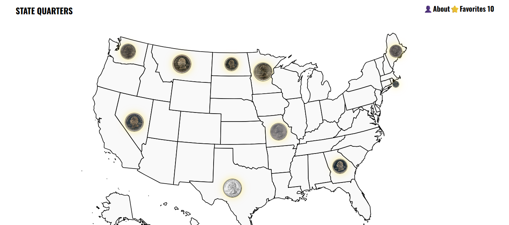
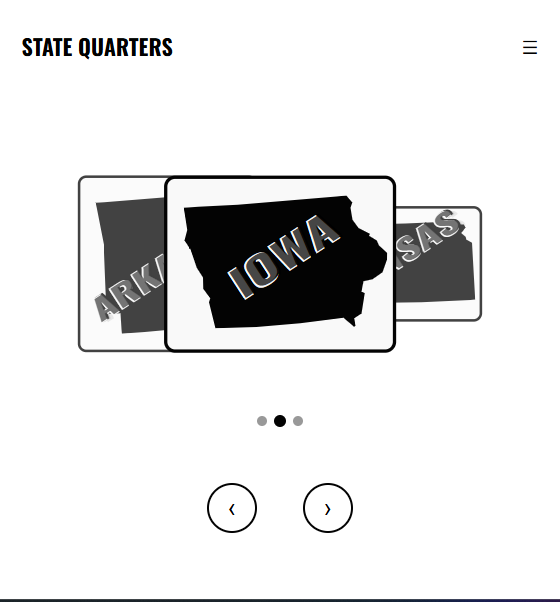

# Coin Collection Frontend

An interactive SVG map for collecting US state quarters, built with vanilla JavaScript. Renders coins on the map for desktop, and uses a carousel and drawer for mobile. Collections persist locally via `localStorage` and sync to your account on login.

**[Live Demo](https://tweber92.github.io/coin-collection-frontend/)** · **[Backend API](https://github.com/TWeber92/coin-collection-backend)**

<table>
  <tr>
    <td width="65%"></td>
    <td width="35%"></td>
  </tr>
  <tr>
    <td align="center"><em>Desktop: SVG map with foreignObject coins</em></td>
    <td align="center"><em>Mobile: carousel navigation</em></td>
  </tr>
</table>

## Tech Stack

- **Vanilla JavaScript** (ESM) — no framework, no build step
- **HTML5 SVG** — interactive state paths and `<foreignObject>` coin overlays
- **CSS** — container queries, `clamp()`, flex/grid
- **Storage** — `localStorage` / `sessionStorage` via a repository abstraction
- **Node.js built-in test runner** — no external test framework
- **Playwright** — end-to-end testing

## Features

- **Interactive map** — each state is a clickable SVG path; coins render inside foreign objects
- **Desktop & Mobile UI** — desktop uses the full map; mobile uses a 3-slide carousel and a hamburger drawer
- **Full lifecycle** — mint a coin from a state, flip heads/tails, add to favorites, archive, restore, delete
- **Offline-first** — anonymous collections live in `localStorage`; no account required to start collecting
- **Sync on login** — anonymous collections merge into the account on login, with favorites winning conflicts
- **Full persistence** — collections survive reloads and sync across devices once authenticated

## Architecture

```
DOM event
  ↓
EventRegister (src/EventRegister.js) — delegated listeners for click/input/submit/pointer/resize/load
  ↓
Router (coin-collection-functions/index.js) — dispatches by `type:/tag/id`
  ↓
Handler (coin-collection-functions/*.js) — per-concern orchestrator; parses event, calls controller
  ↓
Controller (src/coin-collection-controller/*.js) — HTTP ↔ domain boundary; error handling via AppController
  ↓
Service (src/coin-collection-service/*.js) — business logic; merging, syncing, coin placement
  ↓
Repository (src/coin-collection-repository/*.js) — DOM and storage access; holds entity references
  ↓
APIClient / BrowserClient — backend HTTP · localStorage / sessionStorage
```

Each layer has one job. Services never touch `document` or `localStorage` directly — they call repository methods, which are constructed once in `Application.js` and hold their entity (the DOM handle) for the application's lifetime. This keeps the service layer unit-testable without a browser.

**Entity / DTO split:** entities hold live DOM references; DTOs transform them into wire-ready shapes (nodes → counts, dates → formatted strings). Handlers read DTOs; repositories mutate entities.

### Error handling

`AppController` wraps every operation in try/catch. Errors that extend a known type carry a name, status, and message. Unknown errors are logged at `WARN` level. The router's top-level catch formats the final UI response.

## Getting Started

### 1. Install

```powershell
npm install
```

### 2. Configure the API target

The repositories take `api` and `local` clients. In production, `#api` points at the deployed backend. For local development against a local backend, swap to `#local` in `Application.js`:

```javascript
// Production
new CollectionRepository(view, api, local, mq);
```

- `api` = `APIClient("https://coin-api.coin-collection.workers.dev")` (production)
- `local` = `APIClient("https://localhost:3000")` (local backend)

### 3. Run locally

```powershell
npx serve src
```

The frontend is static — no build step. The server starts on `http://localhost:3000`.

## Interaction Model

The interaction model is identical across devices; only the destination changes.

**Desktop**
1. Click a state path on the map → a coin appears in the modal
2. Click the coin → flips to the tails side
3. Click again → the tooltip appears with contextual actions (add, archive, restore, delete)
4. Choose an action → the coin returns to the map as a `<foreignObject>` over its state, or moves to the collection panel

**Mobile**
1. State paths live in a carousel (previous / active / next), not on the map
2. Click a slide → the same coin modal
3. Same flip → tooltip → action flow
4. Coins land in the collection panel (☰ → Favorites / Archive) instead of the map

This branch is driven by `window.matchMedia("(max-width: 768px)")` and injected into repositories at construction, keeping the service layer UI-agnostic.

## Testing

### Unit tests

```powershell
node --import=extensionless/register --import=./tests/fixtures/setup.js --test "tests/*.spec.js"
```

Node's built-in test runner with jsdom, no external dependencies.

**Coverage:**
- `CollectionService` — favorites add, archive move, restore, delete (happy + 401 paths)
- `getUserSyncedCollection` — merge, no-change, unauthenticated branches
- `putCoinsInRespectiveDisplays` — favorites-win re-homing, cross-collection moves, orphan pruning

Tests use mocked repositories and real `localStorage` (via jsdom) — no network, no browser.

### End-to-end tests

```powershell
npx playwright test
```

Playwright drives the full boot → render → interact → persist loop, including the desktop/mobile split, tooltip action selection, and restore-on-reload.

## Project Structure

```
coin-collection-frontend/
├── assets/
│   ├── desktop.png
│   └── mobile.png
├── coin-collection-functions/         # Handlers and router
├── src/
│   ├── coin-collection-controller/    # HTTP ↔ domain
│   ├── coin-collection-service/       # Business logic
│   ├── coin-collection-repository/    # DOM + storage access
│   ├── coin-collection-dto/           # Wire shapes
│   ├── coin-collection-entity/        # Live DOM references
│   ├── coin-collection-view/          # HTML template builders
│   ├── coin-collection-utility/       # Helpers (e.g., GeoUtility)
│   ├── coin-collection-validation/    # Input validators
│   ├── coin-collection-exception/     # Error hierarchy
│   ├── Application.js                 # Composition root
│   ├── DocumentStore.js               # Base element factory
│   ├── EventRegister.js               # DOM event delegation
│   ├── HtmlStore.js                   # Template parser
│   └── View.js                        # Base view class
├── styles/                            # CSS files
├── tests/
│   ├── collection.service.spec.js     # Unit tests
│   ├── fixtures/                      # Mocks, entity builders, jsdom setup
│   └── e2e/                           # Playwright specs
├── playwright.config.js
├── index.html
└── package.json
```

## Notes

- **Client-side merge.** The backend stores the collection verbatim; the frontend computes the merge (`getUserSyncedCollection`) and PUTs the result. Conflict resolution — favorites beat archive — lives in the client.
- **Optimistic failure handling.** A `401` from `/api/me` (expired cookie) is logged as a warning and surfaced as a toast, but local interaction continues. The next authenticated write reconciles.
- **Desktop/mobile branching.** `mq` is read once at construction from `matchMedia` and injected into repositories, so services never query the viewport directly. This is what keeps them testable.
- **`id="state"` on all SVG paths.** Intentional — the event router dispatches on `type:/tag/id`, so every state path shares the same route key. The state name lives in `data-name`.
- **No framework.** Vanilla JS with explicit layering. The test suite is where the structure pays off: services are testable without a browser, and the e2e suite exercises the wiring.